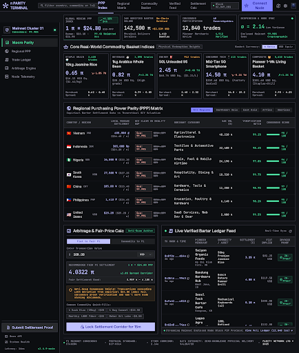

# ⚡ PiBarX — Global Pi Barter Real-Price Index

> **Macroeconomic Purchasing Power Parity (PPP) & Commodity Barter Consensus Engine for the Pi Network Ecosystem.**

[](https://api.mainnet.minepi.com)
[](https://fastapi.tiangolo.com)
[](https://stitch.design)
[](https://www.python.org/)
[](LICENSE)

---

## 🎯 Purpose & Core Mission

The global **Pi Network** ecosystem is currently witnessing the largest decentralized peer-to-peer barter experiment in cryptocurrency history. Across Southeast Asia, Africa, East Asia, Europe, and the Americas, millions of Pioneers are actively trading physical goods and services for Pi coins ($\pi$).

However, the ecosystem suffers from severe **price disorientation**:
1. **Speculative Extremes**: Unverified claims promoting **Global Consensus Value (GCV)** at **$314,159 / $\pi$** lead to non-executable barter listings that freeze physical merchant commerce.
2. **Price Fragmentation**: Local exchanges trade anywhere between **$0.25 and $35.00 / $\pi$**, creating uncertainty and leaving Pioneers vulnerable to mispricing or scam listings.
3. **The Absence of a Macroeconomic Anchor**: Pioneers lack an objective, real-time benchmark answering: ***"What is 1 $\pi$ actually worth in real-world purchasing power today?"***

### The Mission of PiBarX
Inspired by *The Economist's Big Mac Index*, **PiBarX** establishes an empirical, commodity-backed **Purchasing Power Parity (PPP) Index** tailored specifically for the Pi Network barter economy. By indexing real transactions across standardized commodity baskets (Rice, Coffee, Fuel, Hardware, Food Staples) and validating transaction hashes directly against the **Pi Mainnet Horizon Node**, PiBarX provides Pioneers and merchants with a transparent, mathematically grounded fair-price corridor.

---

## 🤝 Community Participation & Contribution Guide

PiBarX is designed as a **decentralized, community-driven oracle**. The accuracy and robustness of the index grow with every verified trade recorded by the Pioneer community. Here is how you can take part:

### 1. 🛒 Everyday Pioneers & Shoppers
* **Log Real Barters**: Whenever you purchase goods or services using Pi (at a local cafe, grocery store, market, or P2P handshake), log the exchange using the **`+ Submit Settlement Proof`** button in the terminal.
* **Provide Transaction Hashes (TxID)**: Copy the 64-character hexadecimal transaction hash from your official **Pi Wallet** app. Providing a valid TxID immediately grants your trade **`● Verified On-Chain`** status, anchoring it to the immutable Pi Mainnet ledger sequence.
* **Audit Transparency**: Click on any transaction hash in the Live Feed table to inspect the transaction directly on the Pi Mainnet Horizon node (`https://api.mainnet.minepi.com/transactions/{tx_hash}`).

### 2. 🏪 Pioneer Merchants & Store Owners
* **Price Standardization**: Use the built-in **Arbitrage & Fair-Price Calculator** to calculate realistic Pi prices for your inventory based on local fiat costs (USD, IDR, VND, NGN, KRW, CNY, PHP, MYR).
* **Adopt the 3-Tier Settlement Corridor**:
  * **Conservative Tier (25th Percentile)**: High-liquidity floor for fast inventory turnover.
  * **Median Consensus (50th Percentile)**: The recommended fair market rate for sustainable daily commerce.
  * **Optimistic Pioneer Tier (75th Percentile)**: Community-supported valuation for Pioneer ecosystem builders.
* **Submit Business Invoices**: Log physical handovers and invoice numbers in the notes field to bolster your merchant consensus score.

### 3. 🖥️ Node Runners & Technical Pioneers
* **Horizon Node Peering**: Configure PiBarX to point to your local Pi Mainnet validator or Horizon instance by setting the `PI_HORIZON_BASE` environment variable.
* **Audit On-Chain Logic**: Review the verification engine in [`backend/blockchain.py`](backend/blockchain.py) to ensure stellar-core compatibility and cryptographic integrity.

### 4. 💻 Open-Source Developers
* **Add Commodity Baskets**: Fork the repository and submit Pull Requests to add regional commodity baskets tailored to your country's agricultural or industrial staples.
* **Build Pi Browser Ecosystem Apps**: Integrate PiBarX's open REST API (`/api/summary`, `/api/calculator`, `/api/commodities`) into Pi Browser dApps, e-commerce storefronts, and point-of-sale (POS) terminals.

---

## 🧠 The Oracle Problem: Why Physical Goods & On-Chain Transactions Differ

### 1. What Blockchain Ledgers Actually Store
In the Pi Network blockchain (built upon the Stellar Consensus Protocol - SCP), each ledger block records purely cryptographic financial operations:
- **Sender Public Key** (`from_address`, e.g. `GANBPA3E...`)
- **Recipient Public Key** (`to_address`, e.g. `GCK76335...`)
- **Amount Transferred** (`amount`, e.g. `12.5000000 π`)
- **Transaction Hash** (`tx_hash`, 64-character hexadecimal)
- **Fee, Ledger Sequence & Confirmation Timestamp**

> ⚠️ **The Pi Blockchain does not and cannot natively store physical product details.**
> Blockchains are financial state machines, not e-commerce inventories. The ledger has no built-in knowledge of whether a `12.5 π` transfer was payment for a 10kg sack of Jasmine Rice, a smartphone repair, or a personal wallet rebalance.

### 2. How PiBarX Acts as the Decentralized Barter Oracle
To bridge physical reality with cryptographic proof, PiBarX creates a dual-layer verification protocol:
1. **Off-Chain Physical Commerce Layer**: Pioneer merchants and buyers log the physical trade details (*Item Name*, *Local Fiat Value*, *Commodity Basket Category*, *City/Country*).
2. **On-Chain Cryptographic Proof Layer**: The transaction's 64-hexadecimal hash (`TxID`) generated in the official Pi Wallet is submitted alongside the trade.
3. **Automated Horizon Node Cross-Audit**: PiBarX queries the official Pi Network Horizon Node (`https://api.mainnet.minepi.com/transactions/{tx_hash}`):
   - Confirms that the transaction exists on the immutable Pi Mainnet ledger.
   - Verifies the exact $\pi$ amount transferred and ledger sequence.
   - Computes the implied purchasing power:
     $$\text{Implied Price} = \frac{\text{Local Market Value (USD)}}{\text{Pi Amount Paid}}$$
   - Tags verified trades as **`● Verified On-Chain`**.

### 3. Multi-Layer Anti-Fake & Outlier Protection
To prevent bad actors from manipulating the index with fabricated or spam transactions:
* **Blockchain Gatekeeper**: Transactions submitted with invalid or non-existent hashes are automatically flagged as `REJECTED_ONCHAIN` and excluded from index computations.
* **Statistical Anomaly Filter**: Extreme outlier submissions (e.g., claiming 1 cup of coffee = 314,159 $\pi$ or 0.00001 $\pi$) are tagged as `OUTLIER_FLAGGED` and trimmed from calculations.
* **Median Robustness (P50)**: By employing the statistical median rather than arithmetic mean, the index is naturally immune to skew from peripheral outliers.

---

## 💎 Key Features

### 1. 🌾 Standardized Commodity Baskets
Tracks the real exchange value of Pi against everyday physical goods across 7 international commodity baskets:
- **Jasmine Rice (10kg)** (`RICE`)
- **Arabica Whole Bean Coffee (1kg)** (`COFFEE`)
- **Gasoline / Transport Fuel (50L)** (`FUEL`)
- **Weekly Food & Groceries Basket** (`GROCERIES`)
- **Mid-Tier 5G Smartphone** (`PHONE`)
- **Commuter Motorbike** (`MOTO`)
- **Personal & Automotive Services** (`SERVICES`)

### 2. 🌍 Country-Level Purchasing Power Parity (PPP)
Real-time implied exchange rates across high-volume Pi barter countries:
- 🇮🇩 **Indonesia (IDR)**
- 🇻🇳 **Vietnam (VND)**
- 🇳🇬 **Nigeria (NGN)**
- 🇰🇷 **South Korea (KRW)**
- 🇨🇳 **China (CNY)**
- 🇵🇭 **Philippines (PHP)**
- 🇺🇸 **United States (USD)**
- 🇲🇾 **Malaysia (MYR)**

### 3. ⛓️ On-Chain Pi Mainnet Hash Verification
Direct cryptographic verification of barter transaction hashes (`TxID`) against the official **Pi Network Mainnet Horizon Node** (`https://api.mainnet.minepi.com/transactions/{tx_hash}`). Each barter entry is tagged with its ledger sequence, confirmation time, and explorer deep-link.

### 4. 🧮 3-Tier Statistical Barter Fair-Price Calculator
Eliminates barter guesswork for both buyers and sellers with instant statistical parity calculations:
- **Conservative Tier (25th Percentile)**: High-liquidity floor for quick liquidation.
- **Median Consensus (50th Percentile)**: Recommended market benchmark for fair transactions.
- **Optimistic Pioneer (75th Percentile)**: Upper boundary for community-supported ecosystem merchants.
- **GCV Divergence Meter**: Real-time percentage delta comparison against speculative valuations.

### 5. 🎨 Obsidian Parity Terminal (Stitch AI Generated)
Engineered using **Google Stitch AI MCP** (`Obsidian Parity Terminal` Design System, Project ID `14493381499494726809`):
- Dual-panel institutional terminal layout (Collapsible Terminal Sidebar + Main Viewport).
- High-density dark mode palette (`#080a0d`, `#0f1218`).
- Financial micro-borders (`#1e2430`) and responsive data tables.
- Monospace typographic accents (`JetBrains Mono`, `Inter`, `Geist`).
- Live blinking heartbeat pulse beacon (`#10b981`).
- Anti-scam consensus shield corridor.

---

## 🖼️ User Interface Preview



---

## 🏗️ Architecture

```
pibar-index/
├── backend/
│   ├── __init__.py
│   ├── main.py              # FastAPI Web & REST Service
│   ├── models.py            # Pydantic Schemas & DTOs
│   ├── database.py          # SQLite Engine & Seed Data with Real Mainnet Hashes
│   ├── blockchain.py        # Pi Mainnet Horizon Verification Client
│   └── analytics.py         # PPP Math, Median Implied Rates & Converter
├── frontend/
│   ├── index.html           # Obsidian Parity Terminal Single Page App
│   ├── css/
│   │   └── terminal.css     # Stitch AI Design System Styles
│   ├── js/
│   │   └── app.js           # Interactive Dashboard & Real-Time Calculator
│   └── assets/
│       └── stitch_preview.png
├── tests/
│   └── test_api.py          # Comprehensive Unit & Integration Tests
├── run.py                   # One-Click Application Launcher (with auto-reload)
├── requirements.txt         # Production Dependencies
└── README.md                # System Documentation & Community Guide
```

---

## 🚀 Quick Start Guide

### Prerequisites
- Python 3.10+ (tested on Python 3.13)
- Modern Web Browser or Pi Browser

### 1. Clone & Setup
```bash
git clone https://github.com/virsi18/pibar-index.git
cd pibar-index
```

### 2. Install Dependencies
```bash
pip install -r requirements.txt
```

### 3. Launch Application
```bash
python run.py
```

The application will start on **`http://127.0.0.1:8000`**.
Open your browser to access the Obsidian Parity Terminal dashboard.

---

## 📡 REST API Reference

| Endpoint | Method | Description |
| :--- | :--- | :--- |
| `/api/summary` | `GET` | Global master KPIs (median implied rate, total volume, active countries, 24h trend). |
| `/api/commodities` | `GET` | Standardized commodity baskets with benchmark rates and 24h percentage deltas. |
| `/api/countries` | `GET` | Country parity index, local fiat equivalents, and active barter volume. |
| `/api/barters` | `GET` | Filterable list of audited barters (supports `commodity`, `country`, `search`, and `limit`). |
| `/api/barters/submit` | `POST` | Audit and index a new barter transaction with on-chain cryptographic check. |
| `/api/calculator` | `GET` | 3-tier statistical fair price conversion calculator. |
| `/api/charts/history` | `GET` | 7-day historical price points for trend visualization. |
| `/api/pi/status` | `GET` | Real-time health, core version, and ledger sequence from Pi Mainnet Horizon node. |
| `/api/pi/live-transactions` | `GET` | Stream latest raw payment transactions directly from Pi Mainnet blockchain. |
| `/api/verify-tx/{tx_hash}` | `GET` | Real-time query to Pi Mainnet Horizon node for transaction details. |
| `/docs` | `GET` | Interactive Swagger / OpenAPI documentation UI. |

---

## 🧪 Running Unit Tests

Run the full automated test suite:

```bash
python -m unittest discover tests
```

---

## ⚖️ Methodology & Disclaimer

1. **Purchasing Power Parity (PPP)**: The implied rate for any commodity is calculated as:
   $$\text{Implied Price per } \pi = \frac{\text{Standard Local Fiat Benchmark (USD)}}{\text{Pi Exchanged}}$$
2. **Median Consensus**: Because peer-to-peer barter transactions contain natural variance, PiBarX utilizes the **statistical median (P50)** rather than the arithmetic mean to protect the index against artificial spikes or speculative distortions.
3. **Disclaimer**: PiBarX is an independent analytical tool for macroeconomic research and fair barter guidance. It is not affiliated with the Pi Core Team. Pi coins cannot be traded for fiat currency during the Enclosed Mainnet period; all calculations are based strictly on direct physical commodity and service exchanges.

---

## 📄 License
Released under the [MIT License](LICENSE).
